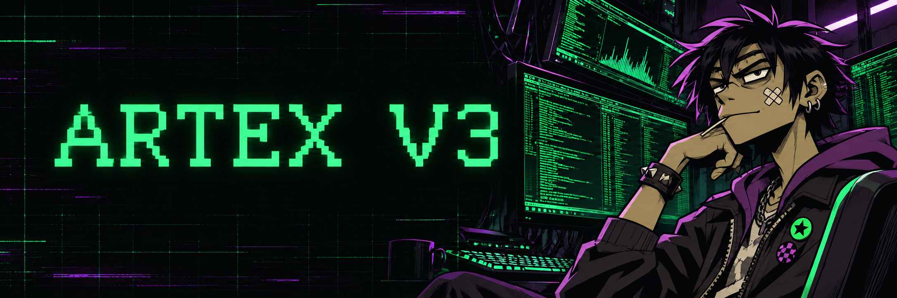

# Artex V3

Cópia portátil da instalação real do [ARTEX de BaaRai](https://github.com/BaaRai/ARTEX) em uma VM Debian, com código, prompts e instruções de restauração. **Artex V3** é o nome deste pacote; o software e as configurações dentro da VM não foram renomeados nem alterados para a publicação.

O disco foi copiado com a VM desligada e validado com qemu-img check. Depois da cópia, a VM original foi iniciada novamente. A [release do backup](../../releases/tag/vm-2026-11-23) contém a VM completa e os arquivos privados criptografados. **A chave de restauração não está no GitHub.**

## Escolha por onde começar

| Quero... | Abra |
|---|---|
| Ver o código ARTEX e as alterações locais | [Código ARTEX](artex/) e [patch local](patches/artex-local.patch) |
| Ler os prompts presentes na instalação | [Prompts](prompts/) |
| Restaurar a VM no mesmo formato | [Preparar o host](#1-preparar-o-host) e [restaurar](#2-restaurar-a-vm) |
| Entender quais dados estão protegidos | [Mapa dos arquivos](#mapa-dos-arquivos) |
| Configurar ou trocar uma API | [API e modelos](#api-e-modelos) |

~~~mermaid
flowchart LR
  A[Repositório público: código e prompts] --> C[Host Linux com KVM]
  B[Release: VM e pacotes criptografados] --> C
  K[Chave fora do GitHub] --> C
  C --> V[VM Debian: ARTEX, banco e configuração]
  C --> H[Integração opcional do host]
~~~

## Mapa dos arquivos

| Arquivo | Acesso | Conteúdo |
|---|---|---|
| [artex/](artex/) | Público | Código original ARTEX e alterações locais do checkout usado, com licença e avisos preservados. |
| [patches/artex-local.patch](patches/artex-local.patch) | Público | Diferença das alterações locais em relação ao commit de origem. |
| [prompts/](prompts/) | Público | Os **cinco arquivos de prompt ainda presentes** na instalação, inclusive o prompt em inglês e backups de versões anteriores. |
| [vm/libvirt/](vm/libvirt/) e [vm/guest/start.sh](vm/guest/start.sh) | Público | Definições da VM, rede, filtro e script de inicialização copiados da instalação. |
| sherlock-v62.qcow2.zst.gpg.chunk-* | Criptografado na release | Disco completo da VM, com Debian, ARTEX, banco, arquivos e configurações no instante da cópia. |
| debian-13.7.0-amd64-DVD-1.iso.chunk-* | Público na release | ISO Debian original usada pela definição da VM. |
| host-config.tar.zst.gpg | Criptografado na release | Credenciais, chaves, serviços e configuração local do host. |
| private-project.tar.zst.gpg | Criptografado na release | Código de integração do host, patch local e cópias dos prompts e definições da VM. |

Os prompts publicados foram examinados para localizar credenciais e dados pessoais. Conversas e transcrições não foram lidas nem exportadas separadamente. Elas podem existir **dentro do disco criptografado**, pois ele preserva o estado completo da VM. O código de integração do host ficou criptografado por conter caminhos e identificadores locais.

<strong>O que é preservado e o que depende do novo computador?</strong>

- A VM conserva o disco, banco, programas, usuários, prompts e configurações existentes na data do backup.
- Os XMLs conservam os caminhos e dispositivos originais: /mnt/sherlock-ssd, tipo de máquina pc-i440fx-noble-v2 e renderizador /dev/dri/renderD128.
- O host novo precisa oferecer esses caminhos e dispositivos para iniciar a VM **sem mudar a configuração**. Se o hardware ou o tipo de máquina não existir, adapte uma cópia do XML; essa adaptação deixa de ser uma restauração idêntica.
- O backup inclui a configuração local da VPN, mas o login da conta Mullvad precisa ser feito no novo computador. A credencial do dispositivo não pôde ser lida no host de origem.
- Os arquivos de prompt disponíveis são os que ainda existiam como arquivos. O estado ativo da aplicação e do banco está no disco da VM.

## 1. Preparar o host

Use Linux x86-64 com virtualização KVM. Reserve pelo menos **50 GB livres** para baixar e reconstruir os arquivos. A VM original usa 2 vCPUs, 2 GiB de RAM e disco virtual de 30 GiB.

<strong>Ubuntu/Debian: instalar ferramentas</strong>

~~~bash
sudo apt update
sudo apt install git gh qemu-kvm qemu-utils libvirt-daemon-system libvirt-clients zstd gnupg
~~~

Confirme os recursos esperados:

~~~bash
ls -l /dev/kvm /dev/dri/renderD128
virsh -c qemu:///system list --all
mountpoint /mnt/sherlock-ssd
~~~

Monte o volume destinado à VM em /mnt/sherlock-ssd antes de continuar. O script verifica esse ponto de montagem e recusa sobrescrever uma VM, rede, filtro, disco ou ISO existente.

<strong>Baixar o projeto e preparar a chave</strong>

~~~bash
git clone https://github.com/glaudsonvilela/artex-v3.git
cd artex-v3
~~~

Copie chave-de-restauracao.txt do computador de origem por um canal separado. A chave local foi salva em ~/Downloads/artex-vm-backup/chave-de-restauracao.txt. **Não a envie ao GitHub nem a coloque dentro deste repositório.**

~~~bash
chmod 600 /caminho/para/chave-de-restauracao.txt
~~~

Sem essa chave, os pacotes criptografados não podem ser restaurados.

## 2. Restaurar a VM

~~~bash
bash restore.sh /caminho/para/chave-de-restauracao.txt
~~~

O script baixa os arquivos da release, verifica [SHA256SUMS](SHA256SUMS), confere a chave, recompõe a ISO e o disco, valida o hash do disco descomprimido e executa qemu-img check. Depois define o filtro, a rede e a VM no libvirt, preservando o início automático da VM que estava configurado na origem. O download e a reconstrução podem demorar conforme a conexão e o armazenamento.

~~~bash
virsh -c qemu:///system start sherlock-v62
virsh -c qemu:///system list --all
~~~

<strong>Restaurar também a integração do host</strong>

Execute **depois** de restore.sh, na mesma conta Linux usada na instalação original:

~~~bash
bash restore-host.sh /caminho/para/chave-de-restauracao.txt
~~~

O script identifica o nome da conta dentro do backup criptografado, restaura o código de integração, as chaves locais e os serviços do usuário. Ele recusa sobrescrever uma instalação existente. Entre na conta Mullvad separadamente antes de ativar o proxy VPN.

~~~bash
systemctl --user daemon-reload
systemctl --user status sherlock-artex-mcp-tunnel.service
systemctl --user status sherlock-vm-vpn-proxy.service
~~~

O serviço de túnel encaminha o painel ARTEX para [http://127.0.0.1:8790](http://127.0.0.1:8790) quando estiver ativo e a VM acessível. Os serviços restaurados preservam os parâmetros originais; confira o estado deles no novo host antes de iniciar tarefas.

## Prompts, API e modelos

<strong>Quais prompts estão incluídos?</strong>

- [auto-chat-prompt.md](prompts/auto-chat-prompt.md)
- [auto-chat-prompt.v6.md](prompts/auto-chat-prompt.v6.md)
- [auto-chat-prompt-v3-backup.md](prompts/auto-chat-prompt-v3-backup.md)
- [auto-chat-prompt-v4-backup.md](prompts/auto-chat-prompt-v4-backup.md)
- [NVIDIA_SYSTEM_PROMPT_Sherlock.md](prompts/NVIDIA_SYSTEM_PROMPT_Sherlock.md), o prompt em inglês da configuração NVIDIA/Sherlock

São cópias de arquivos existentes, inclusive versões antigas. Após iniciar a VM, confira no painel ARTEX em **System → Agents** qual prompt está ativo no banco restaurado. Para mudar o prompt, edite a configuração no painel ou na instalação local.

<strong>Como funcionam as chaves de API?</strong>

As chaves e os perfis que existiam na VM estão dentro do **disco criptografado**. A configuração do host também está criptografada. Nenhum valor de chave deve ser inserido em README, issues, commits ou arquivos públicos.

Se quiser trocar ou adicionar uma chave depois da restauração, abra o painel em **System → LLM**. Edite ou crie o perfil do modelo, preencha **API Key**, ajuste o modelo e a prioridade do pool, salve e use o teste de saúde do perfil. A configuração atual da VM é preservada enquanto você não a editar.

## Conferir a restauração

O script de restauração já confere os hashes e o disco. Para uma verificação adicional:

~~~bash
qemu-img check /mnt/sherlock-ssd/Sherlock-VM/sherlock-v62.qcow2
virsh -c qemu:///system dominfo sherlock-v62
~~~

<strong>Se algo não iniciar</strong>

1. Confira a VM com virsh dominfo e a rede com virsh net-info.
2. Confira /dev/kvm, /dev/dri/renderD128 e o suporte ao tipo de máquina original com qemu-system-x86_64 -machine help.
3. Confirme que /mnt/sherlock-ssd está montado e que o usuário pode usar libvirt.
4. Se a VM funciona mas o painel não abre, confira o serviço sherlock-artex-mcp-tunnel e o endereço local acima.
5. Se o proxy VPN não funciona, entre na Mullvad no host novo e confira o serviço sherlock-vm-vpn-proxy.

## Integridade e origem

Os hashes das partes da release estão em [SHA256SUMS](SHA256SUMS). O hash do disco original descomprimido está em [vm/IMAGE_SHA256](vm/IMAGE_SHA256). Os commits de origem e as alterações locais estão em [SOURCE_SNAPSHOT.md](SOURCE_SNAPSHOT.md).

O ARTEX mantém sua licença e avisos originais em [artex/LICENSE](artex/LICENSE). A integração do host preserva os arquivos de licença que estavam no checkout, dentro do pacote criptografado.
